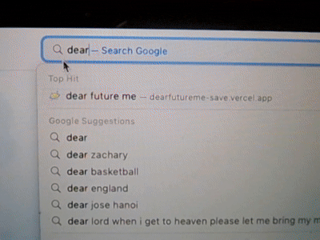

💿 DearFutureMe: manifesting responsibly

DearFutureMe is a cozy online corner for present you to "look out for" future you!

We are a student-led project, with a flagship personal finance web app that helps make budgeting, shopping plans, and future goals feel more visually tangible. This platform gives users a space to visualize their dreams, organize their spending, and mail budgeting plans to their future selves.

_Because dreaming is fun. Why can't budgeting?_

💌 What you can do

01. Make it yours

Customize your mood board. Scroll a little on Pinterest and drop 'em into the space. Write a note to remind yourself before moving on to budgeting. Plans should be visual and personal finance should be inspiring!

02. Budget your way

Input your budget goal. Create shopping lists, record item prices, and give yourself space to prioritize purchases before making them.

03. Write to your future self

Set a future date or time to revisit your dreams and plans. Budgeting beforehand helps you stay prepared and hopeful!

Brainstorming in Feb 2026, building from March 2026, public launch in July 2026

Built with HTML/CSS/Javascript

Hosted on Vercel

Link to space: dearfutureme-save.vercel.app

Active User counts: 3K+

Visit us on Instagram & TikTok at @dearfutureme.save

© 2026 dear future me. made with love <3
